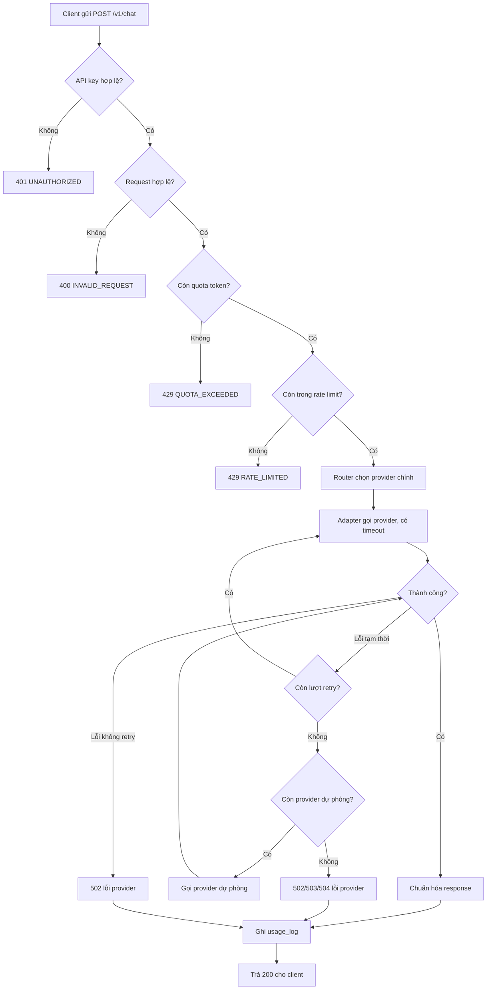

# LLM Gateway: Tài liệu thiết kế

> Trạng thái: bản nháp ngày 1. Các mục đánh dấu **(đề xuất)** là quyết định mình đưa ra để bạn duyệt, hãy sửa nếu bạn có ý khác. Các mục đánh dấu **(cần tra)** là chỗ chưa có dữ liệu thật, cần đối chiếu tài liệu của provider.

## 1. Mục tiêu và phạm vi

Một API trung gian nhận request theo **một định dạng chung**, chọn provider phù hợp, gọi model và trả về **một định dạng response chung**, đồng thời quản lý rate limit, retry, quota token.

**Trong phạm vi**
- Chat (một lượt trả lời đầy đủ, không streaming)
- 2 provider: Groq, Gemini
- Xác thực bằng API key của gateway
- Rate limit, retry, timeout, fallback, quota token, ghi usage log
- Load test bằng JMeter

**Ngoài phạm vi (bản đầu)**
- Streaming (SSE), tool calling, hình ảnh/audio
- Trả nội dung "suy nghĩ" (reasoning) của model cho client
- Giao diện web, Redis, chạy nhiều instance

## 2. Khảo sát provider (dữ liệu thật từ Postman)

Model đã thử: Groq `openai/gpt-oss-120b`, Gemini `gemini-3.6-flash`.

| Thông tin | Groq | Gemini |
|---|---|---|
| Endpoint | `POST https://api.groq.com/openai/v1/chat/completions` | `POST https://generativelanguage.googleapis.com/v1beta/models/{model}:generateContent` |
| Gửi key | Header `Authorization: Bearer <key>` | Header `x-goog-api-key: <key>` |
| Tên model | Trường `model` trong body | Nằm trong URL |
| Danh sách tin nhắn | `messages` | `contents` |
| Nội dung một tin nhắn | `content` là chuỗi | `parts` là mảng, mỗi phần có `text` |
| System prompt | Tin nhắn có `role: system` | Trường riêng `systemInstruction` |
| Vai trò của AI | `assistant` | `model` |
| Giới hạn độ dài | `max_tokens` | `generationConfig.maxOutputTokens` |
| Nhiệt độ | `temperature` | `generationConfig.temperature` |
| Vị trí câu trả lời | `choices[0].message.content` | `candidates[0].content.parts[0].text` |
| Lý do dừng | `choices[0].finish_reason` (đã gặp: `stop`) | `candidates[0].finishReason` (đã gặp: `STOP`, `MAX_TOKENS`) |
| Token vào | `usage.prompt_tokens` | `usageMetadata.promptTokenCount` |
| Token ra | `usage.completion_tokens` (đã **gồm** reasoning) | `usageMetadata.candidatesTokenCount` (chưa gồm suy nghĩ) |
| Token suy nghĩ | `usage.completion_tokens_details.reasoning_tokens` | `usageMetadata.thoughtsTokenCount` |
| Tổng token | `usage.total_tokens` | `usageMetadata.totalTokenCount` |
| Thời gian xử lý | `usage.total_time` (có) | Không có |
| Id của provider | `id` | `responseId` |
| Tên model thực tế | `model` | `modelVersion` |
| Format lỗi | `error.message`, `error.type` | `error.code`, `error.message`, `error.status`, `error.details[].reason` |
| Nội dung suy nghĩ | `choices[0].message.reasoning` | `parts[].thoughtSignature` (chuỗi rất dài, dùng nội bộ) |

**Số liệu đối chiếu (cùng câu hỏi "Spring Boot là gì? Trả lời trong 2 câu.")**

| | Token vào | Token câu trả lời | Token suy nghĩ | Tổng |
|---|---|---|---|---|
| Groq | 98 | 61 (= 107 - 46) | 46 | 205 |
| Gemini (lần 2) | 23 | 67 | 525 | 615 |

Nhận xét:
- Cùng một câu hỏi nhưng token vào chênh nhau (98 so với 23) do tokenizer và định dạng prompt mỗi model khác nhau.
- Gemini: `total = prompt + candidates + thoughts` (23 + 67 + 525 = 615).
- Groq: `total = prompt + completion`, trong đó completion đã chứa reasoning (98 + 107 = 205).
- Với Gemini, `maxOutputTokens` bao gồm cả token suy nghĩ. Lần gọi đầu (`maxOutputTokens` = 200) bị cắt giữa câu với `finishReason: MAX_TOKENS` vì 190 token đã dùng để suy nghĩ.

## 3. Unified request

`POST /v1/chat` với header `X-API-Key: <key của gateway>` **(đề xuất tên header)**.

| Trường | Bắt buộc | Kiểu | Ý nghĩa và quy tắc |
|---|---|---|---|
| `model` | Có | chuỗi | Tên model do gateway định nghĩa, dùng để chọn provider (xem mục 8) |
| `messages` | Có | mảng | Ít nhất 1 phần tử, tối đa 50 **(đề xuất)** |
| `messages[].role` | Có | chuỗi | Một trong `system`, `user`, `assistant` |
| `messages[].content` | Có | chuỗi | Không rỗng, tối đa 20.000 ký tự **(đề xuất)** |
| `maxTokens` | Không | số nguyên | Từ 1 đến 8.192 **(đề xuất)**; mặc định 1.024 **(đề xuất)** |
| `temperature` | Không | số thực | Từ 0 đến 2; mặc định 0.7 |

Quy tắc bổ sung:
- Tin nhắn `system` chỉ được đặt ở đầu danh sách, tối đa một tin **(đề xuất)**.
- Tin nhắn cuối cùng phải có `role` là `user`.
- Trường không nhận diện được trong body thì bỏ qua hoặc báo lỗi? **Chọn: báo lỗi 400** để tránh client tưởng trường đó có tác dụng **(đề xuất)**.
- `maxTokens` là giới hạn cho **toàn bộ token ra, gồm cả suy nghĩ** (đúng với cách Gemini tính). Tài liệu API phải ghi rõ điều này, và khuyến nghị client đặt đủ lớn cho model có suy nghĩ. Gateway giảm lãng phí bằng cách đặt mức suy nghĩ thấp cho Gemini (mục 8).

### Bảng dịch cho adapter

| Unified | Sang Groq | Sang Gemini |
|---|---|---|
| `model` | Trường `model` trong body (tên model của provider) | Đưa vào URL |
| `messages` có role `system` | Giữ nguyên trong `messages` | Tách ra, đưa vào `systemInstruction.parts[].text` |
| Role `assistant` | `assistant` | Đổi thành `model` |
| Role `user` | `user` | `user` |
| `content` (chuỗi) | `content` | Bọc thành `parts` gồm một phần `text` |
| `maxTokens` | `max_tokens` | `generationConfig.maxOutputTokens` |
| `temperature` | `temperature` | `generationConfig.temperature` |

## 4. Unified response

HTTP 200 khi gọi thành công (kể cả khi `finishReason` là `LENGTH`).

| Trường | Kiểu | Lấy từ Groq | Lấy từ Gemini |
|---|---|---|---|
| `requestId` | chuỗi | Gateway tự sinh | Gateway tự sinh |
| `provider` | chuỗi | Gateway điền (`groq`) | Gateway điền (`gemini`) |
| `model` | chuỗi | `model` | `modelVersion` |
| `content` | chuỗi | `choices[0].message.content` | Ghép các `parts[].text` |
| `finishReason` | chuỗi | `finish_reason`, đã chuẩn hóa | `finishReason`, đã chuẩn hóa |
| `usage.inputTokens` | số | `prompt_tokens` | `promptTokenCount` |
| `usage.outputTokens` | số | `completion_tokens` | `candidatesTokenCount` + `thoughtsTokenCount` |
| `usage.reasoningTokens` | số, có thể null | `reasoning_tokens` (nếu có) | `thoughtsTokenCount` (nếu có) |
| `usage.totalTokens` | số | `total_tokens` | `totalTokenCount` |
| `latencyMs` | số | Gateway tự đo | Gateway tự đo |
| `fallbackUsed` | boolean | Gateway điền | Gateway điền |

Ví dụ minh họa (số liệu lấy từ lần gọi Gemini ở mục 2, để hiểu cách cộng token):

```json
{
  "requestId": "req_...",
  "provider": "gemini",
  "model": "gemini-3.6-flash",
  "content": "Spring Boot là một framework mã nguồn mở ...",
  "finishReason": "STOP",
  "usage": {
    "inputTokens": 23,
    "outputTokens": 592,
    "reasoningTokens": 525,
    "totalTokens": 615
  },
  "latencyMs": 0,
  "fallbackUsed": false
}
```

## 5. Quy tắc đếm token

- `outputTokens` = **tất cả token model sinh ra, gồm cả suy nghĩ**, vì đây là phần provider tính tiền và là thứ quota cần phản ánh.
  - Groq: dùng nguyên `completion_tokens` (đã gồm reasoning).
  - Gemini: `candidatesTokenCount + thoughtsTokenCount`.
- `reasoningTokens` chỉ để tham khảo, không cộng thêm vào tổng. Nếu provider không trả thì để null.
- `totalTokens` = `inputTokens + outputTokens`. Nên tự tính lại thay vì tin `totalTokenCount` của provider, để hai bên luôn nhất quán.
- Quota tính theo `totalTokens` đã chuẩn hóa này.
- Lưu ý: token vào của cùng một prompt khác nhau giữa các model, nên quota theo token không phải thước đo công bằng giữa provider. Chấp nhận điều này ở bản đầu.

## 6. Chuẩn hóa `finishReason`

Bảng giá trị gốc của hai provider (đối chiếu lại với tài liệu chính thức vì danh sách có thể thay đổi theo phiên bản API):

| Trường hợp | Groq | Gemini |
|---|---|---|
| Hoàn thành tự nhiên | `stop` | `STOP` |
| Vượt giới hạn độ dài | `length` | `MAX_TOKENS` |
| Bị chặn do an toàn | `content_filter` | `SAFETY` |
| Từ khóa bị cấm | không có | `BLOCKLIST` |
| Thông tin cá nhân nhạy cảm | không có | `SPII` |
| Nội dung bị cấm nghiêm trọng | không có | `PROHIBITED_CONTENT` |
| Nghi trùng bản quyền | không có | `RECITATION` |
| Gọi hàm / công cụ | `tool_calls` | không có `finishReason` riêng (có `functionCall` trong nội dung) |
| Gọi hàm bị lỗi cú pháp | không có | `MALFORMED_FUNCTION_CALL` |
| Khác / không xác định | không có hoặc rỗng | `OTHER`, `FINISH_REASON_UNSPECIFIED` |

### Giá trị chuẩn của gateway

| Giá trị chuẩn | Ý nghĩa | Groq | Gemini |
|---|---|---|---|
| `STOP` | Kết thúc bình thường | `stop` | `STOP` |
| `LENGTH` | Bị cắt do hết `maxTokens` | `length` | `MAX_TOKENS` |
| `CONTENT_FILTERED` | Bị chặn bởi bộ lọc nội dung hoặc chính sách | `content_filter` | `SAFETY`, `BLOCKLIST`, `SPII`, `PROHIBITED_CONTENT`, `RECITATION` |
| `OTHER` | Lý do khác, không xác định hoặc ngoài phạm vi | `tool_calls`, giá trị rỗng, mọi giá trị lạ | `MALFORMED_FUNCTION_CALL`, `OTHER`, `FINISH_REASON_UNSPECIFIED`, thiếu `finishReason`, mọi giá trị lạ |

Quy tắc xử lý:
- `LENGTH`: vẫn trả 200, nhưng ghi cảnh báo vào log. Nếu `content` rỗng hoặc rất ngắn thì ghi chú thêm là có thể `maxTokens` quá nhỏ so với phần suy nghĩ.
- `CONTENT_FILTERED`: trả 200 với `content` rỗng và `finishReason = CONTENT_FILTERED`, vì đây là kết quả hợp lệ của model, không phải lỗi hệ thống **(đề xuất)**. Không đưa lý do chi tiết của provider (ví dụ `SPII`) ra client; chỉ ghi vào log nội bộ.
- `OTHER`: trả 200 và ghi cảnh báo vào log. Tool calling nằm ngoài phạm vi nên gateway không gửi tools; nếu vẫn gặp `tool_calls` hay `MALFORMED_FUNCTION_CALL` thì coi là bất thường cần điều tra.
- Giá trị lạ phải rơi vào `OTHER` chứ không được làm adapter văng lỗi.
- **(cần tra)** Với Gemini, khi prompt bị chặn ngay từ đầu, response có thể **không có `candidates`** mà chỉ có thông tin chặn ở cấp prompt (thường tên là `promptFeedback`). Adapter phải xử lý trường hợp thiếu `candidates` và quy về `CONTENT_FILTERED`, không được ném lỗi truy cập phần tử rỗng.

## 7. Lỗi chuẩn

### Format lỗi của gateway

| Trường | Ý nghĩa |
|---|---|
| `errorCode` | Mã nội bộ, chuỗi ngắn dễ đọc (xem bảng dưới) |
| `message` | Thông điệp cho client, **không chứa** nguyên văn lỗi của provider |
| `requestId` | Mã để truy vết trong log |
| `retryAfterSeconds` | Có thể null, dùng cho lỗi rate limit |

### Bảng lỗi

| Tình huống | HTTP trả cho client | `errorCode` | Retry? | Fallback? |
|---|---|---|---|---|
| Thiếu hoặc sai API key của gateway | 401 | `UNAUTHORIZED` | Không | Không |
| Request sai định dạng (thiếu trường, role sai, vượt giới hạn) | 400 | `INVALID_REQUEST` | Không | Không |
| `model` không có trong cấu hình | 400 | `MODEL_NOT_SUPPORTED` | Không | Không |
| Client vượt hạn mức token | 429 | `QUOTA_EXCEEDED` | Không | Không |
| Client vượt rate limit | 429 (kèm `retryAfterSeconds`) | `RATE_LIMITED` | Không | Không |
| Provider quá tải (Gemini 503 `UNAVAILABLE`) | 503 khi hết retry và fallback | `PROVIDER_UNAVAILABLE` | Có, có backoff | Có |
| Provider trả 5xx khác | 502 khi hết retry và fallback | `PROVIDER_ERROR` | Có, có backoff | Có |
| Provider rate limit gateway (429 từ provider) | 503 khi hết retry và fallback | `PROVIDER_RATE_LIMITED` | Có, có backoff | Có |
| Provider timeout | 504 khi hết retry và fallback | `PROVIDER_TIMEOUT` | Có | Có |
| Key của gateway gửi lên provider bị từ chối (401/403) | 502 | `PROVIDER_AUTH_FAILED` | Không | Có (provider khác) |
| Provider báo request sai (400), thường do adapter hoặc cấu hình lỗi | 502 | `PROVIDER_BAD_REQUEST` | Không | Không (là lỗi của gateway, cần sửa) |
| Lỗi không lường trước trong gateway | 500 | `INTERNAL_ERROR` | Không | Không |

Lưu ý: `LENGTH` (bị cắt do hết token) **không phải lỗi**, trả 200.

### Các lỗi thật đã gặp khi khảo sát

| Lỗi đã gặp | Nguyên nhân | Bài học cho gateway |
|---|---|---|
| Groq `unknown_url` | Gọi sai URL | Endpoint của từng provider để trong cấu hình, kiểm tra khi khởi động |
| Groq `property 'message' is unsupported` | Sai tên trường body | Lỗi 400 của provider nghĩa là adapter map sai, không retry, ghi log để sửa |
| Gemini 401 `API_KEY_SERVICE_BLOCKED` | Key bị giới hạn API | Lỗi xác thực với provider, không retry, cần cảnh báo |
| Gemini 401 `ACCESS_TOKEN_TYPE_UNSUPPORTED` | Gửi key sai kiểu header | Mỗi adapter phải gửi đúng kiểu xác thực |
| Gemini 503 `UNAVAILABLE` | Model quá tải | Lỗi tạm thời, retry có backoff rồi fallback |

Quy tắc: adapter quyết định retry hay không dựa trên **HTTP status và trường `status`/`type` có cấu trúc**, không dựa vào nội dung `message`.

## 8. Chọn provider và routing

Client chỉ biết **tên model của gateway** (alias), không biết provider nào đứng sau. Ánh xạ nằm trong file cấu hình, chưa cần DB.

| Tên model của gateway | Provider chính (model thật) | Provider dự phòng (model thật) |
|---|---|---|
| `chat-fast` | Groq (`openai/gpt-oss-120b`) | Gemini (`gemini-3.6-flash`, mức suy nghĩ thấp) |
| `chat-gemini` | Gemini (`gemini-3.6-flash`, mức suy nghĩ thấp) | Groq (`openai/gpt-oss-120b`) |

Quy tắc:
- Client gửi `model` không có trong bảng thì trả `MODEL_NOT_SUPPORTED`.
- Khi fallback, response ghi `fallbackUsed = true`, còn `provider` và `model` là của nơi thực sự đã trả lời.
- Hai alias đối xứng nhau để cả hai đường (Groq lỗi sang Gemini, Gemini lỗi sang Groq) đều test được ở ngày 10.

### Cấu hình theo từng provider (không lộ ra client)

| Tham số | Giá trị | Ghi chú |
|---|---|---|
| Timeout gọi provider | 30 giây **(đề xuất)** | Chỉnh sau khi load test |
| Số lần retry tối đa | 2 **(đề xuất)** | Cấu hình được, chỉ với lỗi tạm thời |
| Backoff | Tăng dần giữa các lần retry **(đề xuất)** | Ví dụ 1 giây rồi 2 giây |
| Mức suy nghĩ của Gemini | `low` **(đề xuất)** | Đặt qua tham số thinking trong cấu hình generation; xem mục dưới |
| Mức suy nghĩ của Groq | Để mặc định ở bản đầu **(cần tra)** | Model gpt-oss của Groq có thể có tham số mức suy nghĩ riêng, cần tra tài liệu |

### Quyết định về mức suy nghĩ (thinking)

- **Vấn đề đã đo được:** với câu hỏi 2 câu, Gemini dùng 525 token suy nghĩ so với 67 token trả lời (mục 2). Điều này làm tốn quota và dễ bị cắt (`MAX_TOKENS`) khi `maxTokens` nhỏ.
- **Quyết định:** adapter Gemini luôn đặt mức suy nghĩ thấp (`low`, thử `minimal` nếu muốn tiết kiệm hơn) theo cấu hình, **client không điều khiển được** ở bản đầu. Lý do: tránh client vô tình đốt quota, và giữ unified request đơn giản.
- **Đánh đổi:** mức thấp có thể giảm chất lượng với câu hỏi cần suy luận nhiều. Ghi vào phần hạn chế của README.
- **Mở rộng sau (ngoài phạm vi bản đầu):** thêm trường tùy chọn trong unified request cho phép client chọn mức suy nghĩ, adapter tự dịch sang tham số của từng provider.
- Quy tắc đếm token ở mục 5 **không đổi**: vẫn cộng token suy nghĩ vào `outputTokens`, chỉ là con số này sẽ nhỏ hơn.

## 9. Luồng xử lý



Thứ tự các bước và kết quả khi thất bại:

1. Xác thực API key: sai thì 401.
2. Kiểm tra request: sai thì 400.
3. Kiểm tra quota: hết thì 429 `QUOTA_EXCEEDED`.
4. Kiểm tra rate limit: vượt thì 429 `RATE_LIMITED`.
5. Chọn provider theo `model`.
6. Gọi provider qua adapter, có timeout, retry có giới hạn và backoff với lỗi tạm thời.
7. Hết retry thì fallback sang provider dự phòng (nếu có).
8. Chuẩn hóa response (token, finishReason).
9. Ghi `usage_log` cho **cả lần thành công và thất bại**.
10. Trả response.

## 10. Bảng dữ liệu

Dùng JPA entity để sinh schema.

### `api_client`

| Cột | Ý nghĩa |
|---|---|
| `id` | Khóa chính |
| `name` | Tên client |
| `api_key_hash` | **Chỉ lưu bản băm** của key, không lưu key gốc; có chỉ mục duy nhất |
| `daily_token_quota` | Hạn mức token mỗi ngày **(đề xuất: tính theo ngày trước, thêm tháng sau)** |
| `rate_limit_per_minute` | Số request tối đa mỗi phút |
| `status` | `ACTIVE` hoặc `DISABLED` |
| `created_at` | Thời điểm tạo |

### `usage_log`

| Cột | Ý nghĩa |
|---|---|
| `id` | Khóa chính |
| `request_id` | Mã truy vết, trùng với `requestId` trả cho client |
| `client_id` | Tham chiếu `api_client` |
| `requested_model` | Tên model client yêu cầu |
| `provider` | Provider thực sự trả lời (có thể null nếu lỗi trước khi gọi) |
| `actual_model` | Tên model thực tế do provider trả |
| `input_tokens`, `output_tokens`, `reasoning_tokens`, `total_tokens` | Theo quy tắc ở mục 5 |
| `latency_ms` | Thời gian gateway xử lý |
| `status` | `SUCCESS` hoặc `ERROR` |
| `error_code` | Mã lỗi chuẩn, null nếu thành công |
| `finish_reason` | Giá trị đã chuẩn hóa, null nếu lỗi |
| `retry_count` | Số lần đã retry |
| `fallback_used` | Có dùng fallback hay không |
| `created_at` | Thời điểm ghi |

Quyết định cho bảng:
- **Không lưu nội dung prompt và câu trả lời** trong `usage_log` **(đề xuất)**, vì không cần cho quota và tránh lưu dữ liệu nhạy cảm của người dùng.
- Cần chỉ mục trên (`client_id`, `created_at`) vì quota được tính bằng cách cộng `total_tokens` theo client trong khoảng thời gian.
- Chỉ tính quota trên các bản ghi có token, lần lỗi không tốn token thì không trừ.
- Ở bản đầu, quota tính bằng truy vấn tổng trên `usage_log`. Nếu load test cho thấy đây là điểm nghẽn thì tối ưu ở ngày 12.

## 11. Các quyết định thiết kế (để dùng khi phỏng vấn)

| Quyết định | Lý do |
|---|---|
| Mỗi provider là một adapter sau một interface chung | Thêm provider mới chỉ cần thêm một class, không đổi schema chung |
| Schema chung chỉ giữ trường cả hai provider đều hỗ trợ | Tránh lộ chi tiết riêng của provider ra client |
| `outputTokens` gồm cả token suy nghĩ | Khớp với cách provider tính tiền, quota phản ánh đúng chi phí |
| `maxTokens` là giới hạn toàn bộ token ra | Khớp ngữ nghĩa của Gemini, nên ghi rõ trong tài liệu API |
| `LENGTH` và `CONTENT_FILTERED` trả 200 | Là kết quả hợp lệ của model, không phải lỗi hệ thống |
| Quyết định retry dựa trên mã trạng thái có cấu trúc | Nội dung `message` của provider không ổn định |
| Gemini luôn chạy mức suy nghĩ thấp, do cấu hình quyết định | Giảm token lãng phí (525 so với 67 trong phép đo), client không tự đốt quota |
| Lưu hash của API key | Lộ DB không làm lộ key |
| Không lưu nội dung hội thoại | Giảm rủi ro dữ liệu nhạy cảm |

## 12. Việc cần làm tiếp và câu hỏi còn mở

- [x] Danh sách giá trị `finish_reason` của Groq và `finishReason` của Gemini đã có ở mục 6; còn cần đối chiếu lại với tài liệu chính thức và kiểm tra trường hợp Gemini trả response không có `candidates`
- [x] Quyết định mức suy nghĩ: adapter Gemini đặt mức thấp theo cấu hình (mục 8)
- [ ] **(cần tra)** Tên tham số thinking chính xác trong body REST của Gemini (vị trí trong `generationConfig` và tên viết camelCase hay snake_case) và các giá trị hợp lệ cho model đang dùng
- [ ] Gọi lại Gemini với mức suy nghĩ thấp, ghi `thoughtsTokenCount` mới và so với 525 để có số liệu "trước và sau" cho README
- [x] Tên model chuẩn và bảng định tuyến (mục 8): `chat-fast`, `chat-gemini`
- [ ] Chốt các giới hạn đề xuất ở mục 3 (số tin nhắn, độ dài, `maxTokens` tối đa)
- [ ] Quyết định quota theo ngày hay theo tháng ở bản đầu

## 13. Tiêu chí xong ngày 1

- [x] Đã gọi thành công cả hai provider bằng Postman
- [x] Có bảng so sánh hai provider
- [x] Có unified request/response, quy tắc đếm token, ánh xạ `finishReason`
- [x] Có bảng lỗi chuẩn và sơ đồ luồng
- [x] Có hai bảng dữ liệu
- [ ] Bạn đã đọc lại, sửa các mục **(đề xuất)** theo ý mình và chốt các mục **(cần tra)**